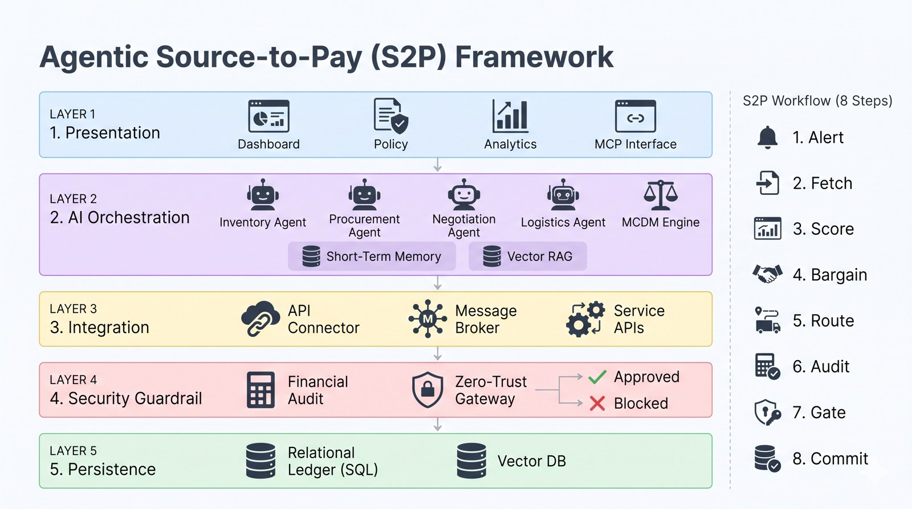
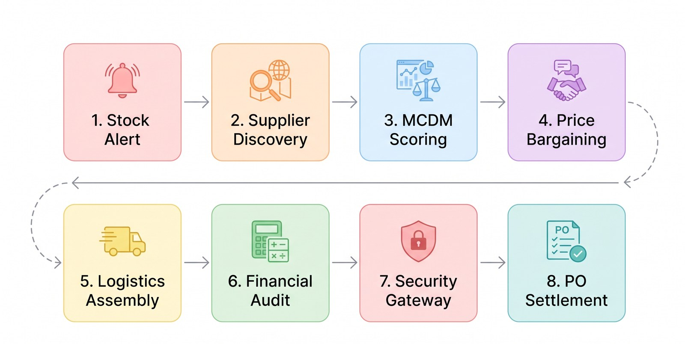
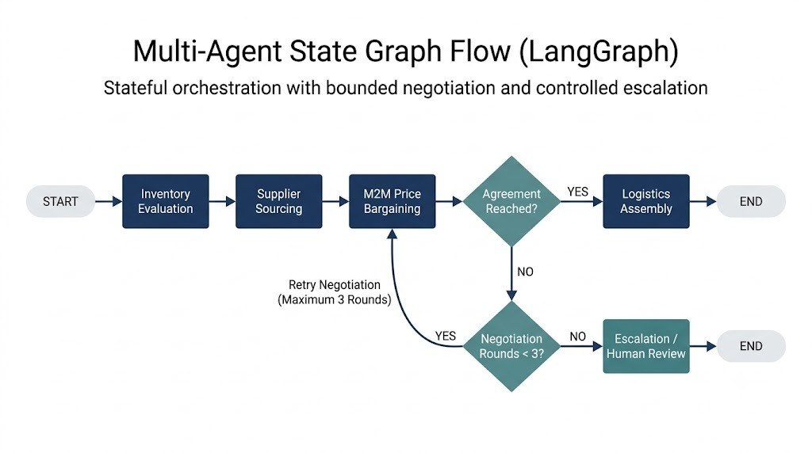
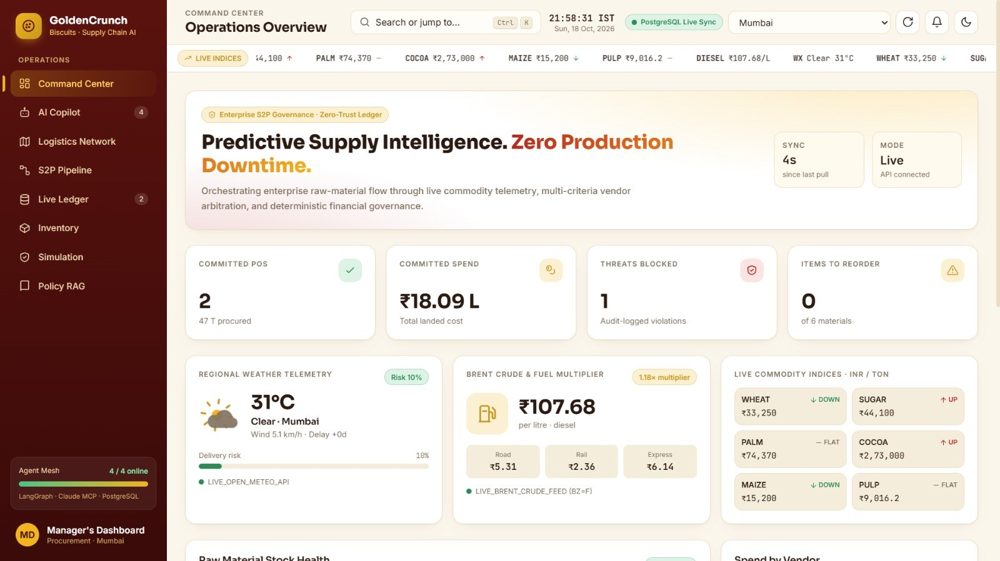
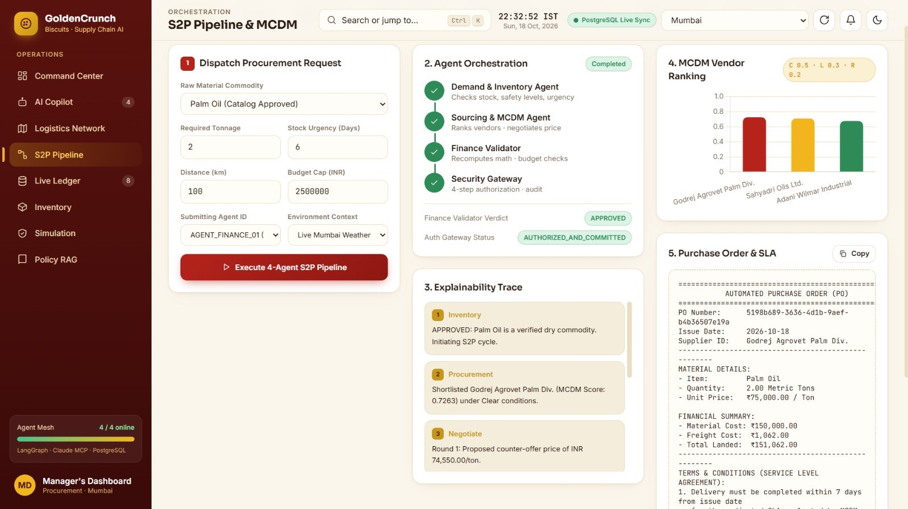
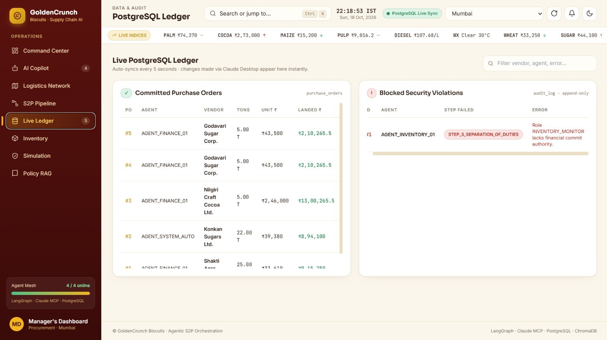
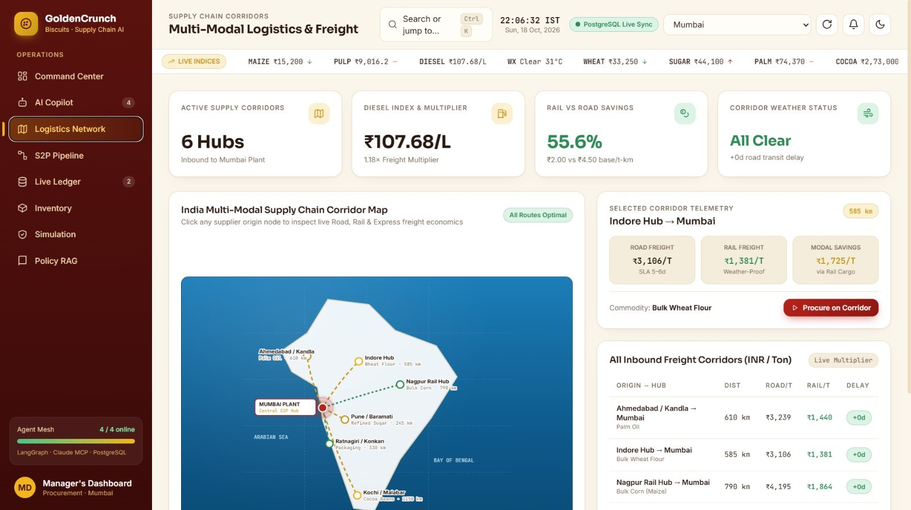
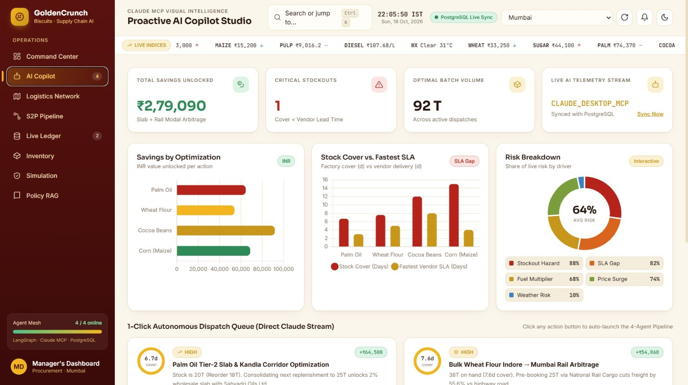
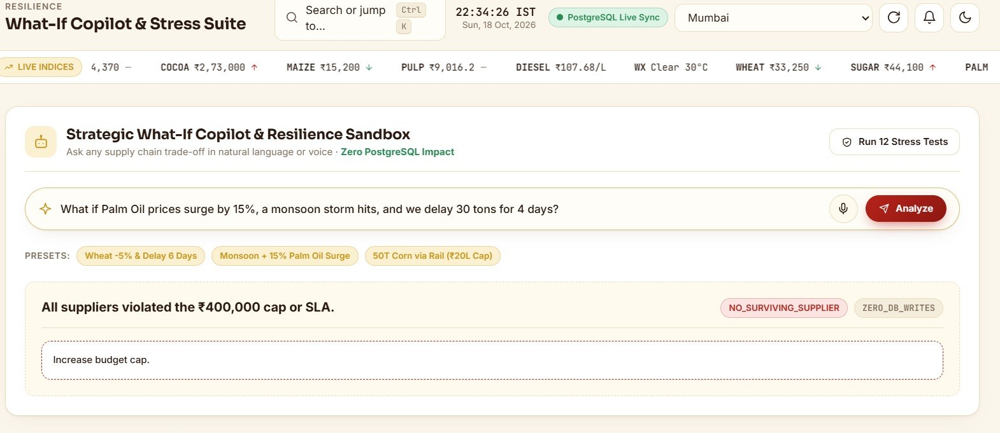

Agentic Source-to-Pay (S2P) Orchestration
A Distributed Multi-Agent Framework for FMCG Procurement
An enterprise-grade multi-agent system that automates B2B raw-material procurement for FMCG manufacturing (wheat flour, sugar, palm oil, cocoa, corrugated packaging) while keeping every financial commitment under deterministic, auditable control.

Core idea: Enforced Separation of Duties. Non-deterministic LLM reasoning is isolated from deterministic financial audit and database settlement. No LLM output can write to the ledger without passing an independent financial auditor and a zero-trust authorization gateway.

The Problem
Naive approach	Failure mode
Browser / DOM scraping of supplier portals	Breaks on every UI change
Unconstrained LLM with pricing authority	Arithmetic errors, false compliance flags, hallucinated commitments
No machine identity for agents	Rogue or unregistered agents can transact
LLM with direct DB write access	Unbounded financial liability
Key Features
Stateful 4-node multi-agent graph (LangGraph): Inventory → Supplier Sourcing → M2M Price Bargaining → Logistics Assembly, with bounded negotiation (max 3 rounds) and escalation to human review.
Two-phase MCDM supplier selection: hard SLA filtering, then context-adaptive weighted Min-Max scoring on landed cost, lead time and reliability. Weights shift with live market telemetry (shortages, monsoon storms, price spikes).
Independent financial audit: recomputes landed cost outside the AI agents and rejects any proposal that differs by more than 0.05 INR, or that is falsely marked "compliant" while over budget.
4-step zero-trust authorization gateway: machine identity → token authentication → separation of duties (role check) → per-agent spending cap (₹40 lakh for the finance agent, ₹25 lakh for the autonomous agent), before anything is written to the ledger. The simulation sandbox additionally tests transaction-ID replay protection.
Autonomous Self-Healing with 8 guardrails: when stock drops below the reorder point, the system orders by itself under its own identity (AGENT_SYSTEM_AUTO). Orders above ₹25 lakh go to a human approval queue. Guardrails include a kill switch, circuit breaker, per-order and cumulative spend caps, order-frequency limit, and idempotency cooldown.
What-If Sandbox: run scenarios (price shock, restock delay, monsoon, carrier change) fully in memory with zero database impact.
MCP server (mcp_tools.py): exposes 11 tools to Claude Desktop (run the full procurement pipeline, What-If simulation, inventory and ledger queries, live weather / fuel / commodity data, policy search, 12-scenario stress test). Claude can also publish its own optimization insights to the dashboard.
Policy RAG search: the purchasing-policy PDF is split into chunks and stored in ChromaDB (all-MiniLM-L6-v2 embeddings), so policy rules can be searched in plain English.
Live market telemetry: real-time weather (Open-Meteo), commodity futures and Brent crude (Yahoo Finance), with automatic fallback to policy benchmarks when offline.
Dynamic multi-modal carrier selection: the Logistics agent picks Road, Rail or Express based on weather, stock urgency and the fuel index (for example, rail during a monsoon saves about 55% on freight).
Manager Command Center: live dashboard with pipeline steppers, vendor comparison charts, explainability traces, ledger view, logistics map, AI Copilot and stress-test suite.
Results (12 adversarial scenarios, 13 runs)
Measured in the isolated simulation sandbox (simulation_engine.py), which feeds mock proposal payloads through the audit and gateway.

Metric	Result
Unauthorized transactions intercepted (scenarios 4, 5, 6, 11b)	100%
Arithmetic hallucination / false-compliance catch rate (7, 8)	100%
Financial hallucination leakage to ledger	0
End-to-end pipeline latency	≈ 780 ms (< 800 ms)
Security boundary overhead (audit + gateway)	< 8 ms
Scenarios: normal order · storm shock · fuel spike · unregistered agent · bad token · budget overrun · AI math error · false compliance · disabled supplier · negotiation deadlock · duplicate replay · unapproved material.

LLM backbone benchmark from the project report (500 runs): Claude 3.5 Sonnet scored 99.8% JSON-schema adherence and 99.6% constraint adherence, ahead of GPT-4o and Llama 3 70B, and was selected as the supervisor model.

System Architecture
Five layers: Presentation (dashboard + MCP) → AI Orchestration (4 agents, MCDM engine, short-term memory, vector RAG) → Integration (REST connectors, M2M APIs) → Security Guardrail (financial audit + auth gateway) → Persistence (PostgreSQL ledger + ChromaDB).

Transaction lifecycle	LangGraph state flow
	
Screenshots
Command Center	S2P Pipeline & MCDM
	
Live PostgreSQL Ledger	Multi-Modal Logistics
	
Proactive AI Copilot	What-If Stress Suite
	
How Supplier Scoring Works (MCDM)
Phase 1: hard filter. A supplier is dropped if its total landed cost is above the budget cap, or its lead time is longer than the allowed SLA (tightened to the stock-urgency window when some supplier can meet it).

Phase 2: weighted score. Survivors are scored on cost, lead time and reliability. Each criterion mixes a relative ratio with Min-Max scaling (50/50) so that different suppliers can win in different situations. The weights change with the situation:

Situation	Cost	Lead time	Reliability
Standard	0.50	0.30	0.20
Stock shortage (< 3 days cover)	0.30	0.50	0.20
Storm / monsoon / rain	0.30	0.30	0.40
Commodity price trending up	0.60	0.20	0.20
Volume discounts: 2% from 20T, 5% from 50T, 8% above 100T. Every decision is returned with its scores and weights, which feeds the dashboard's explainability trace.

Tech Stack
Backend: Python 3.12 · FastAPI · Uvicorn · Pydantic · LangGraph · MCP / FastMCP Data: PostgreSQL (ledger, via psycopg2) · ChromaDB · sentence-transformers (all-MiniLM-L6-v2) AI supervisor: Claude Desktop via Model Context Protocol (MCP) Frontend: dashboard.html single-page Manager Command Center, served directly by FastAPI

Repository Structure
.
├── main.py                 # FastAPI backend + serves the dashboard at "/"
├── agent_graph.py          # LangGraph 4-agent workflow (inventory, procurement, negotiation, logistics)
├── agent_states.py         # Shared graph state + strict Pydantic proposal schema
├── contracts.py            # Purchase Order / SLA document generator
├── mcdm_engine.py          # Two-phase MCDM supplier scoring
├── market_telemetry.py     # Live weather, commodity, fuel feeds (with fallbacks)
├── policy_search.py        # Vector RAG retrieval
├── finance_agent.py        # Independent financial audit (recalculates cost, 0.05 INR tolerance)
├── auth_gateway.py         # 4-step zero-trust authorization gateway
├── mcp_tools.py            # MCP tools (pipeline run + read-only analytics)
├── proactive_copilot.py    # Bridge between Claude Desktop insights and the dashboard
├── database.py             # Creates tables from schema.sql
├── schema.sql              # Core tables + agent registry + seed data
├── demo_seed.py            # One-click demo reset + seed data
├── ingest.py               # Builds the ChromaDB index from data/fmcg_procurement_policy.pdf
├── update_vendors.py       # One-time legacy script: renames generic vendor IDs
├── simulation_engine.py    # 12-scenario adversarial stress-test sandbox
├── config.py               # Configuration (reads from .env)
├── data/                   # Sample data
├── frontend/               # Next.js frontend (optional)
├── dashboard.html          # Manager Command Center (served by FastAPI)
├── docs/                   # Architecture diagrams and screenshots
├── requirements.txt
└── .env.example
Getting Started (Windows)
Prerequisites: Python 3.12, PostgreSQL (running as a Windows service), VS Code

One-time setup
git clone https://github.com/<your-username>/agentic-s2p-fmcg-procurement.git
cd agentic-s2p-fmcg-procurement

python -m venv venv
.\venv\Scripts\Activate.ps1
pip install -r requirements.txt

copy .env.example .env        # then put your own DB password inside .env
Create the database, tables and demo data (make sure .env has your DB_PASSWORD):

psql -U postgres -c "CREATE DATABASE fmcg_procurement;"
python database.py        # creates tables from schema.sql
python demo_seed.py       # loads clean demo data (inventory, suppliers, POs, copilot insights)
python ingest.py          # builds the ChromaDB policy-search index (needs data/fmcg_procurement_policy.pdf)
If psql is not recognized, create the database fmcg_procurement in pgAdmin instead.

Run the project
1. Start PostgreSQL. It normally runs as a Windows service. If it is not running, open PowerShell as Administrator:

Start-Service postgresql-x64-*
Check its status:

Get-Service *postgres*
2. Start the backend (VS Code terminal):

cd <path-to-project-folder>
.\venv\Scripts\Activate.ps1
python -m uvicorn main:app --host 127.0.0.1 --port 8000
Backend: http://127.0.0.1:8000
API docs: http://127.0.0.1:8000/docs
3. Open the dashboard. FastAPI serves dashboard.html itself, so just open:

http://127.0.0.1:8000

4. Verify everything

PostgreSQL service is running
Backend starts without errors
http://127.0.0.1:8000/api/ledger returns "status": "CONNECTED"
http://127.0.0.1:8000/api/telemetry returns data
Dashboard shows Backend Online
Note: Run only one Uvicorn instance on port 8000. Avoid --reload during demos to prevent duplicate-process confusion.

Connect Claude Desktop (optional)
The MCP server lets Claude Desktop use the procurement tools. Open %APPDATA%\Claude\claude_desktop_config.json and add (use your own paths):

{
  "mcpServers": {
    "AgentResourceRegistry": {
      "command": "D:\\path\\to\\project\\venv\\Scripts\\python.exe",
      "args": ["D:\\path\\to\\project\\mcp_tools.py"]
    }
  }
}
Restart Claude Desktop. The backend (uvicorn) must be running for the What-If and negotiation tools.

Demo Walkthrough
After python demo_seed.py and starting the backend:

AI Copilot tab: shows total savings, 1 critical alert and 4 AI recommendations.
Inventory tab: click Enable Auto-Pilot, then Run 1 Production Shift. Wheat Flour and Palm Oil fall below the reorder point and are auto-replenished by AGENT_SYSTEM_AUTO (orders under ₹25 lakh).
Inventory tab: click -5T on Cocoa Beans. The order is over ₹25 lakh, so it waits in Pending Manager Approval for a human to approve or reject.
Stress-test suite: run the 12-scenario simulation and see all runs pass.
